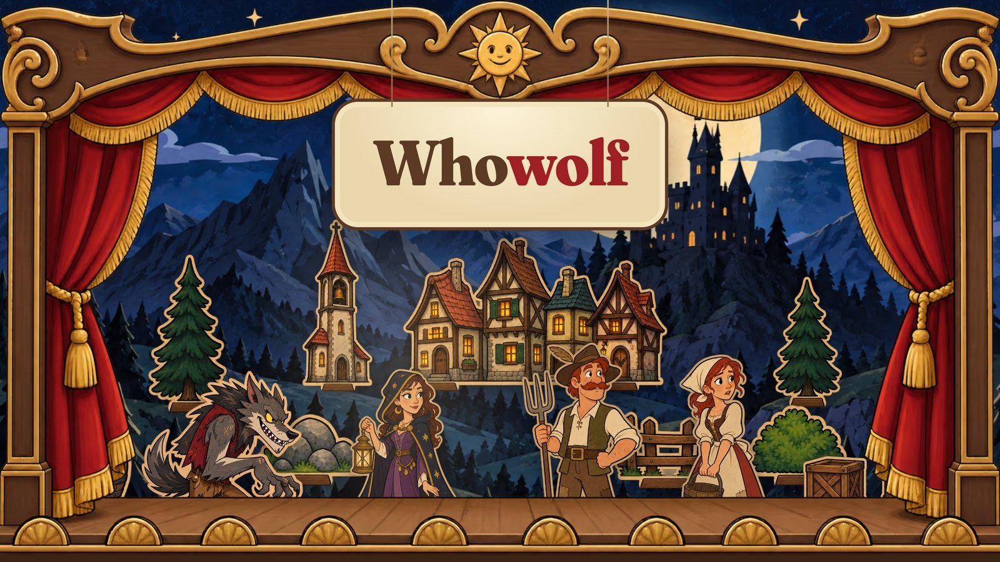
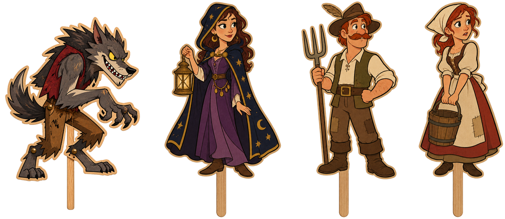
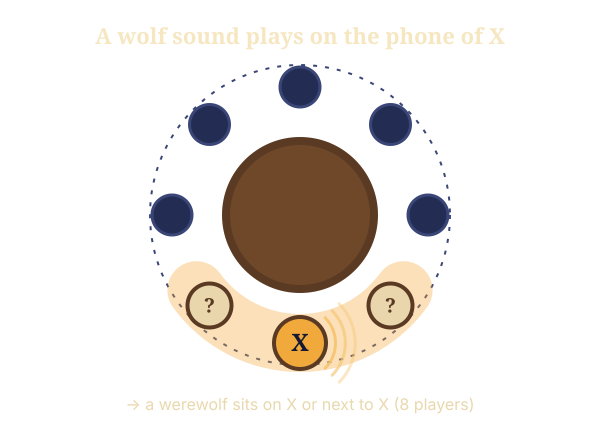

<p align="center">
  <a href="https://whowolf.de"></a>
</p>

<h3 align="center">Werewolf at the table. Everyone on their own phone. The app is the narrator.</h3>

<p align="center">
  <a href="https://whowolf.de">whowolf.de</a> ·
  <a href="docs/ROADMAP.md">Roadmap</a> ·
  <a href="docs/GAME_DESIGN.md">Game design</a> ·
  <a href="SECURITY.md">Security</a>
</p>

<p align="center">
  
  
  
  
</p>

---

Whowolf is an open-source take on the classic social deduction party game. You sit together in one room and talk, accuse and lie face to face. Every player holds their own phone, so roles stay secret, nobody has to sit out as game master, and no rule is ever forgotten.

> [!NOTE]
> Whowolf is in active development and not playable yet. Follow along on the [roadmap](docs/ROADMAP.md) – the first release is a local Wi-Fi version for Android and desktop.

## How it plays

<p align="center">
  
</p>

|  |  |
|---|---|
| **Everyone has a phone** | Scan the host's QR code and you're in. Your role appears on your screen only. |
| **The app narrates** | Night and day, votes and rules run automatically, so everybody gets to play. |
| **Nobody gives themselves away** | At night *every* player taps something. Werewolf or decoy – you can't tell from the outside. |
| **Phones down by day** | During discussion the screen dims to the table circle. Read faces, not displays. |

## The wolf trail



At night the phones on the table whisper – wind, footsteps, an owl. And sometimes a quiet growl.

**The rule everyone knows:** if a wolf sound comes from the phone of **X**, a werewolf sits on **X** or right next to them.

Whoever hears it on their own phone learns a lot – but to everyone else, *they* are now the suspect. Villagers want their volume up, werewolves would rather mute. Then, at dawn, every phone yawns.

A suspicion, never proof. Only possible because everyone has their own device.

<br clear="right">

## Principles

- **Local first.** One phone hosts the game over your Wi-Fi. No server, no internet, no account required.
- **Secure by design.** Every connection is end-to-end encrypted, clients only ever receive what they're allowed to know, and even message timing hides who the werewolves are. See the [threat model](docs/SECURITY_DESIGN.md).
- **Fair.** Free, open source, no ads, no in-app purchases, no tracking.
- **One codebase.** Flutter and Dart for Android, iOS, macOS, Windows and Linux; the game rules live in a pure Dart package shared by everything.
- **Original.** All names, texts and artwork are our own ("Mondbühne" art direction, see [design](docs/DESIGN.md)).

## Roadmap

| Milestone | Goal | Status |
|---|---|---|
| M0 · Foundation | Workspace, CI, tooling | ◐ in progress |
| M1 · Game rules | Complete, tested game logic in `game_core` | ○ |
| M2 · Host & LAN | Devices play over Wi-Fi, encrypted, with rejoin | ○ |
| M3 · App prototype | First real round at a table | ○ |
| M4 · Wolf trail | Night sounds across all phones | ○ |
| M5 · Playtesting | Balance and reliability | ○ |
| M6 · Release 0.1 | GitHub release + website | ○ |
| Design & website | "Mondbühne" look, [whowolf.de](https://whowolf.de) | ◐ website v1 built |

After 0.1: browser join without install, more roles, app stores, and an optional relay server for remote players. Details in the [roadmap](docs/ROADMAP.md).

## Repository

```
whowolf/
├── packages/game_core/   Game rules, roles and phases (pure Dart, shared)
├── packages/protocol/    Versioned messages between host and clients   (M2)
├── packages/game_host/   Host logic: rooms, sessions, timers           (M2)
├── app/                  Flutter app for all platforms                 (M3)
├── website/              whowolf.de (Astro, GitHub Pages)
├── design/               Art direction, character sheets, prompts, credits
├── tool/                 Developer and asset scripts
└── docs/                 Planning documents
```

## Documentation

| Document | Content |
|---|---|
| [Vision](docs/VISION.md) | What Whowolf is and what makes it different |
| [Game design](docs/GAME_DESIGN.md) · [Night sounds](docs/NIGHT_SOUNDS.md) | Game flow, roles and the wolf trail |
| [Architecture](docs/ARCHITECTURE.md) | Host, transports, protocol, later relay server |
| [Security design](docs/SECURITY_DESIGN.md) | Threat model and secure-by-design measures |
| [Design](docs/DESIGN.md) | Art direction "Mondbühne" |
| [Tooling](docs/TOOLING.md) | "It just works" developer tooling |
| [Market analysis](docs/MARKET.md) | Existing apps and positioning |
| [Roadmap](docs/ROADMAP.md) · [Decisions](docs/DECISIONS.md) | Milestones and decision log |
| [Legal notes](docs/LEGAL.md) | License, trademarks, AI-generated assets |

The planning documents are written in German; code, comments and this README are in English.

## Contributing

Ideas, playtests and pull requests are welcome once the foundation is in place. For security issues, please follow the [security policy](SECURITY.md) instead of opening a public issue.

## License

Code: [Apache License 2.0](LICENSE). Artwork in `design/` is original to this project; see [design credits](design/CREDITS.md).
