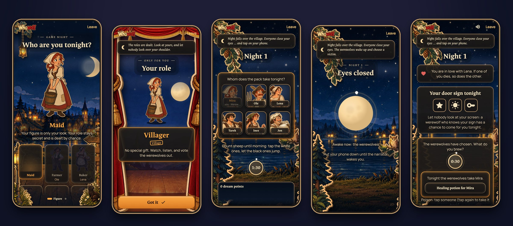
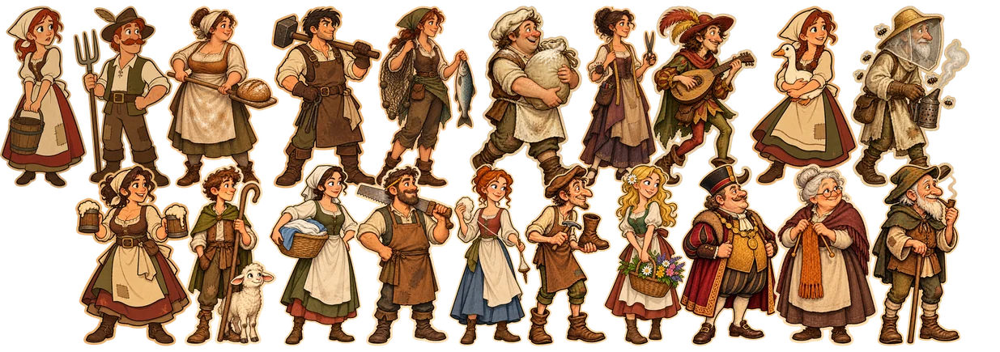

<p align="center">
  <a href="https://whowolf.de"></a>
</p>

<h3 align="center">The werewolf game for your table, narrated by the app.</h3>

<p align="center">
  <a href="https://whowolf.de">Website</a> ·
  <a href="https://github.com/nurkert/whowolf/releases">Download</a> ·
  <a href="https://whowolf.de/docs/">Player guide</a> ·
  <a href="docs/ROADMAP.md">Roadmap</a>
</p>

<p align="center">
  <a href="https://github.com/nurkert/whowolf/releases"></a>
  <a href="https://github.com/nurkert/whowolf/actions/workflows/ci.yml"></a>
  <a href="https://github.com/nurkert/whowolf/releases"></a>
  <a href="LICENSE"></a>
</p>

> [!NOTE]
> **Developer beta.** Whowolf is playable on your own Wi-Fi, end-to-end encrypted, on Android, iPhone, Mac, Windows and Linux. Give every device at the table the same version, and until the independent security review is done, play with people you know.

## How it plays

You sit together and play Werewolf the way you always have: you talk, accuse and lie to each other's faces. The difference is that everyone holds their own phone. It shows your role and, at night, your move. The app deals the roles, runs the night, counts the votes and knows every rule, so nobody has to sit out as game master.

- **Your role stays on your phone.** One phone opens a room, the others scan its QR code. No account, no sign-up.
- **Two kinds of night.** In the *classic* night everyone closes their eyes and a recorded narrator calls the roles one by one. In *Whowolf's* night everyone keeps their phone in hand and taps: while the wolves choose, the villagers count sheep, so nobody stands out.
- **Local first.** One phone hosts the game over your Wi-Fi. Every connection is end-to-end encrypted with libsodium. No ads, no tracking.
- **Built for a real evening.** A dropped connection, a locked screen, even a host who leaves: the game carries on and everyone returns to exactly where they were.
- **A stage by moonlight.** Every phase is a painted cardboard stage set, with puppets, curtains and lanterns that flicker.

<p align="center">
  
</p>

## The cast

<p align="center">
  
</p>

Everyone picks one of twenty villagers, ten women and ten men. The figure says nothing about your role: only when you look at your phone does it turn around, dressed as werewolf, seer, witch, hunter, cupid or plain villager. Start with werewolves and a seer, or switch on every role there is.

## Download

Get the latest build from the [releases](https://github.com/nurkert/whowolf/releases): an APK for Android, a disk image (`.dmg`) for macOS, an installer (or a ZIP to run without installing) for Windows, and for Linux a `.deb`, an `.rpm`, a Flatpak, an AppImage and a plain archive. The iPhone version follows via TestFlight. Every release is built by GitHub Actions from this repository, with SHA-256 checksums and build provenance. The builds are not signed by Apple or Microsoft yet; the release notes say how to open them.

## Build from source

You need Flutter 3.44.8 (Dart 3.12).

```bash
flutter pub get        # resolves the whole workspace
tool/check.sh          # what CI runs: format, analyze, tests
cd app && flutter run  # on a device or desktop of your choice
```

## Repository

| Path | Content |
|---|---|
| `app/` | The Flutter app for every platform |
| `packages/game_core/` | The rules in pure Dart, shared and fully tested |
| `packages/` | Host logic, protocol, the encrypted channel and a command-line client |
| `server/` | Relay server for playing beyond one Wi-Fi (in progress) |
| `website/` | [whowolf.de](https://whowolf.de) (Astro), with the player guide and downloads |
| `design/` | Art direction, figures, prompts and credits |
| `docs/` | Vision, game design, architecture and security design (German) |
| `tool/` | Check, release and asset scripts |

## Contributing and security

Playing helps most: tell us what got stuck at your game night. Bug reports, ideas and pull requests are welcome, see [CONTRIBUTING.md](CONTRIBUTING.md). Please report security issues privately as described in [SECURITY.md](SECURITY.md).

## No warranty, self-hosting

Whowolf is a free hobby project. The software is provided as is under the Apache License 2.0, without warranty of any kind (sections 7 and 8 of the license). The official services (whowolf.de, play.whowolf.de, the releases in this repository) may change, pause or end at any time; their [terms of use](https://whowolf.de/en/terms/) apply.

Anyone may run their own relay, website or build. Whoever does is responsible for that deployment and for its own imprint, privacy policy and terms where the law asks for them; copies never show the official site's legal pages. See [server/deploy/README.md](server/deploy/README.md) for the optional legal links of a relay.

## License

Code under the [Apache License 2.0](LICENSE). All artwork in `design/` was made for this project, see the [design credits](design/CREDITS.md).
