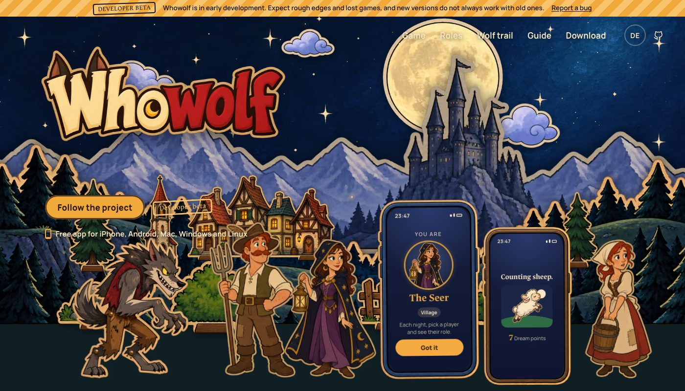

  

  <strong>Werewolf at the table. Everyone on their own phone. The app is the narrator.</strong> 
  <a href="https://whowolf.de">whowolf.de</a> · <a href="https://whowolf.de/docs/">Player guide</a> · <a href="https://github.com/nurkert/whowolf/releases">Download</a> · <a href="docs/ROADMAP.md">Roadmap</a>

  

> [!NOTE]
> **Developer beta.** Whowolf is playable with friends in your own Wi-Fi, end-to-end encrypted, on iPhone, Android, Mac, Windows and Linux. Expect rough edges, give every device at the table the same version, and only play with people you trust until the independent security review is done.

## The idea

Werewolf lives on secrets. Whowolf puts them where they belong: on each player's own phone. You still sit together, talk, accuse and lie face to face. The app hands out roles, runs the night, counts votes and never forgets a rule, so nobody has to sit out as game master.

- **Everyone has a phone.** Scan the host's QR code and you're in. Your role appears on your screen only.
- **Nobody gives themselves away.** At night every player taps something. While the wolves hunt, the villagers count sheep.
- **Local first.** One phone hosts the game over your Wi-Fi. No server, no account, no ads, no tracking.
- **Nothing breaks the evening.** Lost connections, a locked screen, even a host who closes the app: everyone simply carries on where they were.

  

## The cast

  

Every role is a cardboard puppet with its own character. Playable now: werewolves, seer, witch, hunter, cupid (with the lovers) and villagers, from a plain **Classic** game like the card game to the **Full stage**. Twenty figures, ten women and ten men, let everyone at the table pick how they look; the protector and three roles that exist only in Whowolf are on the programme.

## The wolf trail

At night the phones on the table whisper: wind, crickets, an owl. And sometimes, one day, a quiet growl.

If a wolf sound comes from the phone of **X**, a werewolf sits close by: at most one seat away, up to three in big groups.

Whoever hears it on their own phone learns a lot, but to everyone else *they* are now the suspect. Villagers want their volume up, werewolves would rather mute. Then, at dawn, every phone yawns.

The first release plays the night sounds and the yawn; the growl itself comes after it.

 

## Platforms

One Flutter codebase for iPhone, Android, Mac, Windows and Linux (`.deb`). Releases are built by CI with SHA-256 checksums and build provenance; the builds are not signed by Apple or Microsoft yet, see the release notes for how to open them.

## Repository

| Path | Content |
|---|---|
| `app/` | Flutter app |
| `packages/` | Game rules and host logic in pure Dart |
| `website/` | [whowolf.de](https://whowolf.de) (Astro) with the docs and download pages |
| `design/` | Art direction, figures, prompts and credits |
| `docs/` | Planning documents (German), published as the [docs](https://whowolf.de/docs/) |
| `tool/` | Developer, release and asset scripts |

## Contributing and security

Bug reports, ideas and pull requests are welcome: see [CONTRIBUTING.md](CONTRIBUTING.md). Please report security issues privately as described in [SECURITY.md](SECURITY.md).

## License

Code under the [Apache License 2.0](LICENSE). Artwork in `design/` is original to this project, see the [design credits](design/CREDITS.md).
