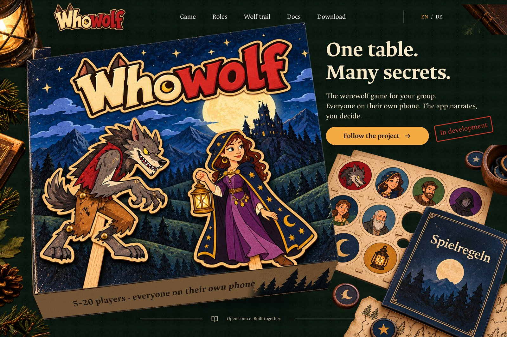
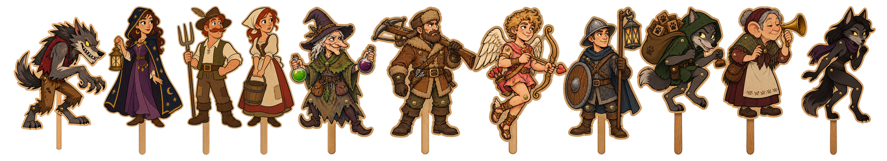

  

  <strong>Werewolf at the table. Everyone on their own phone. The app is the narrator.</strong> 
  <a href="https://whowolf.de">whowolf.de</a> · <a href="https://whowolf.de/docs/">Docs</a> · <a href="https://github.com/nurkert/whowolf/releases">Pre-releases</a> · <a href="docs/ROADMAP.md">Roadmap</a>

  

> [!NOTE]
> Whowolf is a concept in active development. There is nothing to play yet; the `0.0.x` pre-releases are build tests.

## The idea

Werewolf lives on secrets. Whowolf puts them where they belong: on each player's own phone. You still sit together, talk, accuse and lie face to face. The app hands out roles, runs the night, counts votes and never forgets a rule, so nobody has to sit out as game master.

- **Everyone has a phone.** Scan the host's QR code and you're in. Your role appears on your screen only.
- **Nobody gives themselves away.** At night every player taps something. While the wolves hunt, the villagers count sheep.
- **Local first.** One phone hosts the game over your Wi-Fi. No server, no account, no ads, no tracking.

## The cast

  

Every role is a cardboard puppet with its own character. The first release starts with werewolf, seer and villagers; witch, hunter, cupid and protector are on the programme, and three roles exist only in Whowolf.

## The wolf trail

At night the phones on the table whisper: wind, footsteps, an owl. And sometimes a quiet growl.

If a wolf sound comes from the phone of **X**, a werewolf sits close by: at most one seat away, up to three in big groups.

Whoever hears it on their own phone learns a lot, but to everyone else *they* are now the suspect. Villagers want their volume up, werewolves would rather mute. Then, at dawn, every phone yawns.

 

## Platforms

One Flutter codebase. iPhone and Mac come first, followed by Android, Windows and Linux (`.deb`). Pre-releases are built by CI with checksums and build provenance.

## Repository

| Path | Content |
|---|---|
| `app/` | Flutter app |
| `packages/` | Game rules and host logic in pure Dart |
| `website/` | [whowolf.de](https://whowolf.de) (Astro) with the docs and download pages |
| `design/` | Art direction, figures, prompts and credits |
| `docs/` | Planning documents (German), published as the [docs](https://whowolf.de/docs/) |
| `tool/` | Developer, release and asset scripts |

## Contributing and security

Ideas and pull requests are welcome once the foundation is in place. Please report security issues privately as described in [SECURITY.md](SECURITY.md).

## License

Code under the [Apache License 2.0](LICENSE). Artwork in `design/` is original to this project, see the [design credits](design/CREDITS.md).
