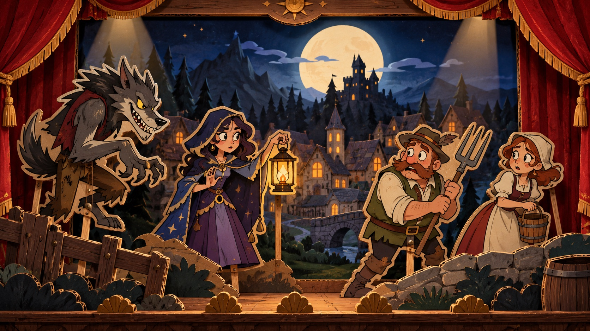

# Design – „Mondbühne“

> Der Stil für **alles**: App, Website, Store-Bilder, Social Media. Referenz: [`design/reference/mondbuehne.jpg`](../design/reference/mondbuehne.jpg).
> Stand: 2026-10-26, beschreibt die gebaute Website und App.

## Leitidee

Whowolf ist ein **Puppentheater bei Mondlicht**. Jede Partie ist eine Vorstellung, die Spieler sind das Ensemble, die App ist die Bühne mit Erzähler.

- **Alles ist eine flache Pappfigur:** Figuren, Häuser, Bäume, Requisiten und auch die Hintergrundebenen. Jedes Stück hat einen hellen **Kartonrand**. Die Figuren **stehen frei**, ohne Stab (seit 2026-10-25).
- **2,5D durch Ebenen:** Die Pappstücke stehen hintereinander. Scrollen verschiebt die Ebenen unterschiedlich stark. Es gibt nie echtes 3D.
- **Cartoon der 2000er, aber edel:** kräftige Konturen, ausdrucksstarke Gesichter, warmes Bühnenlicht.
- **Halb gruselig, halb verschmitzt:** Der Werwolf grinst, die Dorfbewohner schauen nervös, die Laternenträgerin weiß mehr, als sie sagt.
- **Laute Illustration, leise Oberfläche:** Die Bühne gehört den großen Momenten, die Bedienung ist ruhig und präzise.

## Das Bühnenmodell (Website-Startbild)

Von hinten nach vorn, jede Ebene ein eigenes Pappstück (`design/source/stage/ebene_*.png`, Requisiten in `design/source/props/`). Der Faktor sagt, wie stark eine Ebene beim Wegscrollen zurückbleibt (mehr = weiter hinten).

| Ebene | Inhalt | Faktor |
|---|---|---|
| Himmel | gemalter Nachthimmel mit Sternen | 0,55 |
| Mond | Pappscheibe | 0,50 |
| Wolken | drei Pappwolken (auf dem Handy eine) | 0,46 |
| Berge | Bergkette mit Burg als Streifen | 0,42 |
| Hügel | bewaldete Hügel als Streifen | 0,36 |
| Wiese | Wiese, auf der Dorf und Kirche stehen | 0,30 |
| Hinterkulisse | Kirche, Häuser, Tannen | 0,30 |
| Mittelkulisse | Steine, Büsche, Zaun | 0,18 |
| Figuren | Puppen und zwei Papp-Handys | 0,07 |

Bei `prefers-reduced-motion` bewegt sich nichts.

## Bewegung

**Grundsatz:** wie echte Puppen, nicht wie digitale Animation. Kurze, leicht federnde Kurven, höchstens eine größere Bewegung gleichzeitig.

- **Wippen:** Figuren kippen leicht um ihren Fußpunkt.
- **Auftritt:** Figuren gleiten seitlich herein oder kommen von unten hoch.
- **Wenden:** Eine Pappfigur dreht sich wie ein Aufsteller und zeigt danach ihre gespiegelte Seite. Es gibt nur ein Bild, keine eigene Rückseite.
- **Startbild-Geschichte:** Die fünf Szenen spielen einmal beim Laden ab (gut 4 Sekunden), unabhängig vom Scrollen.
- **Schriftzug:** Der große Whowolf-Schriftzug wandert beim Scrollen in den Header und wird dort zum Logo.
- **Bühnenmoment (App):** Bei jedem Phasenwechsel erscheint kurz eine Bühnenkarte: Mond bei Nacht, Sonne am Tag, Waage zur Abstimmung, Pokal am Ende. Ein Tipp schließt sie; bei reduzierter Bewegung entfällt sie.
- **Schäfchen:** hüpfen über die Wiese und springen über den Zaun.

## Farben

**Eine Quelle:** [`design/tokens.json`](../design/tokens.json). `dart run tool/tokens.dart` erzeugt daraus die CSS-Variablen der Website (`website/src/styles/tokens.css`) und die Flutter-Palette (`app/lib/src/palette.g.dart`); `tool/check.sh` schlägt fehl, wenn eins davon veraltet ist.

| Token | Verwendung |
|---|---|
| `night-950` … `night-500` | Hintergründe und Flächen der Nacht, App-Hintergrund |
| `moon-100`, `moon-200` | heller Text auf Nacht, Mondlicht |
| `paper`, `paper-deep`, `ink`, `ink-soft` | Papierflächen (Website-Tafeln, Karten) und ihr Text |
| `lantern-400` | **Akzent:** was man antippen soll, Auswahl, Laternenschein |
| `curtain-400`, `curtain-600` | Gefahr, Werwölfe, „tot“ |
| `gold-500`, `card-200`, `wood-700`, `forest-700` | Borten, Kartonrand, Holz, Wald |

**Regeln:** Nachts dominiert `night`. Der Akzent wird sparsam eingesetzt. `curtain` ist für Tod und Gefahr reserviert. Kontraste nach WCAG AA.

## Logo und Schrift

- **Logo:** handgeletterter Schriftzug „Whowolf“ als Pappfigur (Wolfsohren am „W“, Mondsichel im „o“, „wolf“ in Vorhangrot) plus rundes **Emblem** (Werwolfkopf vor dem Vollmond) für App-Icon, Favicon und kleine Flächen. Dateien: `design/source/brand/`.
- **Überschriften App:** **Lilita One**. **Überschriften Website:** **Ancizar Serif**. **Text:** **Manrope**. Alle SIL OFL, mitgeliefert, nichts von fremden Servern.

## Website

- **Startbild:** die Pappbühne oben als Puppenspiel in fünf Szenen mit zwei Papp-Handys, die echte App-Bildschirme zeigen (Daten aus `website/src/lib/phone-screens.ts`, später austauschbar gegen echte Screenshots).
- **Darunter:** Papiertafeln mit goldener Doppelborte auf Nachtblau (Programmheft, Besetzung, Wolfsspur, Hausregeln, Fortschritt), dazu das spielbare Schäfchenzählen.
- **Download-Seite:** erkennt das Betriebssystem und stellt dessen Download groß nach vorn.
- **Anleitung (`/docs/`):** Regelbuch-Seiten auf Papier mit Seitenleiste, Figuren neben den Titeln; die Planungsdokumente getrennt unter „Für Entwickler“.

## App: Kernkomponenten

- **Persona-Porträt:** rundes Porträt, auf das Gesicht der Pappfigur zugeschnitten (Brennpunkt pro Figur). Steht für den Spieler, verrät nie die Rolle.
- **Tischkreis:** der Tisch aus der eigenen Perspektive, man selbst unten, die Nachbarn links und rechts. In der Lobby (der Gastgeber tauscht Plätze) und am Tag (mit Schäfchen-Zahlen).
- **Rollenkarte:** verdeckt mit dem Emblem; ein Tipp zeigt die Rollenfigur, Name und Erklärung.
- **Schäfchenwiese:** Tarnaufgabe in der Nacht, Herdengröße vom Spiel.
- **Bühnenmoment:** siehe Bewegung.
- **Prüfzeichen:** drei große Symbole (aus 16) zum Vergleichen am Tisch, wenn jemand ohne QR-Code beitritt.
- **Erzählerzeile:** kursive Zeile mit Mond-Symbol über dem Inhalt, auf dem Host-Gerät zusätzlich gesprochen.
- **Nacht:** dunkel und für alle gleich aufgebaut, damit niemand am Bildschirm auffällt (Anti-Tell).

## Figuren-Regeln

- Klare Silhouette, auch klein als Porträt erkennbar.
- Kräftige dunkle Kontur, gleichmäßiger heller Kartonrand, **kein Stab**.
- **Alle Figuren schauen nach rechts.** Gewendet schauen sie nach links.
- Figuren dienen als **Personas** (Aussehen der Spieler) und als Illustration der Rollen. Persona-Namen sind bewusst andere als die Rollennamen (z. B. „Laternenträgerin“, „Grauwolf“).
- **Komplett eigene Designs.** Keine Anlehnung an bestehende Serien, Spiele oder Figuren (siehe [LEGAL.md](LEGAL.md)).

## Asset-Pipeline

- **Erzeugung** mit der Codex-Bildgenerierung, immer mit Referenzbildern aus dem Projekt als Stilvorlage.
- **Sammelbögen:** mehrere Elemente pro Bild auf transparentem Hintergrund (spart Kontingent und hält den Stil einheitlich), dann mit `tool/assets/slice_sheet.py` ausschneiden und mit `clean_alpha.py` säubern.
- **Prompts versioniert** in `design/prompts/`, Herkunft in `design/CREDITS.md`, in die Bilder eingebettet.
- **Ordner:** `design/reference/` (Stilreferenzen), `design/source/` (Originale), `design/sheets/` (Sammelbögen); optimiert (AVIF/WebP) in Website und App (`app/assets/figures`, `app/assets/sheep`).

## Offene Punkte

- Tag-Variante der Bühne (Morgenlicht).
- Echte App-Screenshots statt nachgebauter Screens im Startbild.
- Bühnenhintergrund auch in der App (bisher nur Nachtblau mit Figuren).
