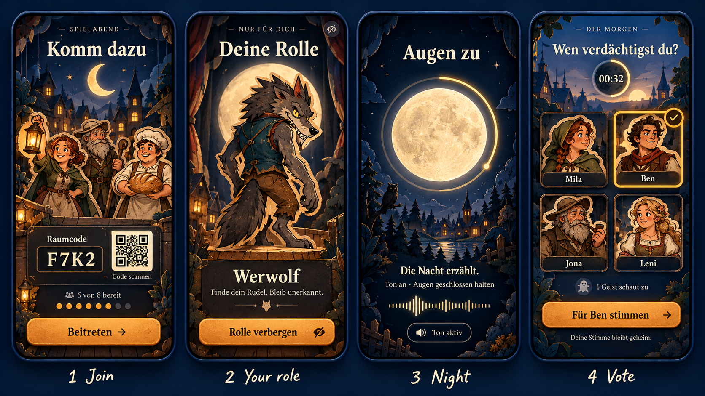

# Task 012 – Das neue Bühnenbild der App

**Status:** umgesetzt (2026-10-27), Website angeglichen. Die Bildrate ist auf iPhone 15, macOS und in Chrome gemessen; auf Android nur im Emulator, weil kein Gerät da ist (siehe Prüfliste).
**Roadmap:** 0.2.0 „Die Bühne“
**Referenz:** [`design/reference/ui_concept_v1.png`](../../design/reference/ui_concept_v1.png) (Codex, 2026-10-27, Prompt in [`design/prompts/ui_concept.md`](../../design/prompts/ui_concept.md)), vom Eigentümer als Richtung bestätigt.

## Ziel

Die App sieht aus wie das Konzept: Jeder Bildschirm ist **ein beleuchtetes Bühnenbild bei Mondlicht**, in dem die Pappfiguren in echtem Raum stehen. Die Bedienung liegt ruhig und hochwertig davor. Das gilt für jeden Bildschirm und jeden Zustand, auf Handy, Tablet, Desktop und im Browser. Die Spielregeln, das Netz und die Geheimhaltung ändern sich nicht. Es ändert sich nur, wie es aussieht und sich anfühlt.

**Nicht Ziel:** neue Spielfunktionen, ein neues Logo, die Website. Die Website wird erst nach der App angeglichen (Phase 7).

## Was das Konzept ausmacht

Daran messen wir jeden Bildschirm. Abgeleitet aus dem Konzeptbild:

1. **Ein Bühnenbild pro Moment.** Jeder Bildschirm hat eine eigene Szene: Dorf am Abend zum Beitreten, Theater mit Vorhang für die Rolle, Nachtsee unter Vollmond, Dorf in der Dämmerung zur Abstimmung. Die Szene füllt den Bildschirm von Rand zu Rand, die Bedienung liegt darauf.
2. **Der Mond ist das Leitmotiv und hat eine Aufgabe.** Er zeigt die Tageszeit (Sichel am Abend, Vollmond in der Nacht, Sonne am Morgen) und dient als Uhr. Der Leuchtring um den Mond ist der Timer, auf dem Abstimmungsbildschirm wird er zur kleinen Uhr.
3. **Rahmen aus Kulisse.** Bäume, Häuser, Laternen und Vorhänge rahmen links und rechts den Inhalt, wie Seitenkulissen einer Bühne. Die Mitte bleibt frei für das Wichtige.
4. **Die Figuren sind die Helden.** Sie stehen groß und warm beleuchtet in der Szene, mit hellem Kartonrand. Neu gegenüber dem Konzept: Sie stehen **in echtem 3D**, also geneigt, mit sichtbarer Wellpappkante und weichem Schatten auf dem Boden. Das können wir schon (`TurningFigure`, siehe DESIGN.md).
5. **Ein klarer Satz oben.** Eine kleine Dachzeile in Kapitälchen mit Strichen („— SPIELABEND —“), darunter ein großer Titel in einer warmen Serifenschrift („Komm dazu“, „Deine Rolle“, „Augen zu“, „Wen verdächtigst du?“).
6. **Eine Hauptaktion unten.** Ein breiter Knopf in Laternenorange mit Pfeil oder Symbol, groß genug für den Daumen. Darüber höchstens eine Plakette mit dem Nötigsten (Raumcode, Rolle, Timer).
7. **Plaketten aus dunklem Holz und Karton** für Informationen. Sie sind halbtransparent dunkel mit feiner goldener Kante und warmem Text, wie Schilder auf der Bühne.
8. **Wenig Text, große Schrift, viel Luft.** Ein Satz Erklärung statt eines Absatzes. Alles andere liegt eine Ebene tiefer (Hilfe, Details).
9. **Die Nacht ist fast schwarz und für alle gleich.** Mond, Himmel, kaum Bedienung, dazu der Hinweis, dass der Erzähler spricht.
10. **Warmes Licht gegen kühle Nacht.** Tiefes Nachtblau und Tinte als Grund, Laternenorange und Mondgold als Licht. Rot nur für Gefahr und Tod.

**Was wir am Konzept bewusst ändern:**

- **Figuren:** Im Konzept wirken sie wie Aufkleber. Bei uns sind sie Pappfiguren in 3D (siehe Punkt 4).
- **Mond-Timer in der Nacht:** Er darf **keine Restzeit** zeigen. In der klassischen Nacht sehen nur die Aufgerufenen die Restzeit (SECURITY_DESIGN, „Die klassische Nacht“), sonst verriete ein Timer, wann jemand gewählt hat. Der Ring in der Nacht läuft deshalb gleichmäßig über die ganze Nacht, aus dem Phasenbeginn und der eingestellten Nachtlänge, für alle gleich. Die Aufgerufenen sehen ihre Restzeit nur in ihrer eigenen Aufgabe.
- **Tonwelle „Die Nacht erzählt“:** Sie bewegt sich nicht nach dem tatsächlichen Pegel des eigenen Handys. Weil der Erzähler wandert, wäre das zwar öffentlich, sähe aber auf jedem Handy anders aus. Sie folgt dem gesprochenen Satz (an, wenn der Erzähler spricht), auf allen Handys gleich.
- **„1 Geist schaut zu“:** Das ist erlaubt, denn wie viele tot sind, ist öffentlich. Geisterwissen selbst erscheint nur im gedrückten Geisterblick.

## Was bleibt (nicht verhandelbar)

- **Geheimhaltung** nach SECURITY_DESIGN: Die Nacht ist für alle gleich aufgebaut (Anti-Tell). Kein Bildschirm zeigt, was der Spieler nicht wissen darf. Geisterwissen gibt es nur gehalten. Keine Animation, kein Klang und keine Farbe hängt von einer geheimen Rolle ab, außer auf dem eigenen, verdeckt angesehenen Rollenbildschirm.
- **Figuren-Regeln** aus DESIGN.md: eigene Designs, Kartonrand, schauen nach rechts, Personas verraten nie die Rolle.
- **Barrierefreiheit:** Kontrast nach WCAG AA, Schrift skaliert mit der Systemeinstellung bis 200 %, jede Aktion mit Bildschirmleser-Beschriftung, Ziele mindestens 48 × 48 dp, bei reduzierter Bewegung keine großen Bewegungen.
- **Alles läuft offline**, keine Schriften oder Bilder von fremden Servern.
- **Eine Quelle für Farben:** `design/tokens.json` erzeugt die Palette der App und der Website.

## Das Designsystem

### Farben (Tokens)

Bestehende Tokens behalten ihre Namen und werden nachgeschärft. Neue kommen hinzu. Endwerte legt Phase 1 nach Messung am Konzeptbild fest, mit Kontrastprüfung.

| Token | Rolle | Richtung aus dem Konzept |
|---|---|---|
| `night-950` … `night-500` | Grund, Himmel, Plaketten | tieferes, satteres Nachtblau (`#0B1530` bis `#2A3A66`) |
| `ink-900` (neu) | fast schwarze Flächen der Nacht | Blauschwarz, nie reines Schwarz |
| `moon-50` … `moon-300` | Mondlicht, heller Text | warmes Elfenbein bis Mondgold |
| `lantern-300` … `lantern-600` | Hauptaktion, Auswahl, Laternenlicht | Orange mit goldenem Verlauf (Knopf hat oben helleres Licht) |
| `gold-400`, `gold-600` | feine Kanten, Ring, Häkchen | Messing, nie gelb |
| `curtain-400`, `curtain-700` | Vorhang, Gefahr, Tod | Theaterrot |
| `wood-600`, `wood-800` | Plakettenkanten, Bühnenrand | dunkles Holz |
| `card-200` | Kartonrand der Figuren | helles Beige |
| `dawn-300` (neu) | Morgen- und Abendhimmel | Rosé bis Pfirsich für die Dämmerung |

### Schrift

- **Titel:** eine warme, gut lesbare Buchserife mit Charakter, wie im Konzept. Kandidaten (SIL OFL, mitlieferbar): **Ancizar Serif** (schon auf der Website, dann sind App und Website gleich), Alegreya, Fraunces. Entscheidung in Phase 0 mit den Konzepttafeln. Lilita One wird ersetzt.
- **Dachzeile:** dieselbe Serife in Kapitälchen mit weiter Laufweite, mit kurzen Strichen davor und danach.
- **Text und Bedienung:** Manrope bleibt (400/600/800).
- **Zahlen** (Raumcode, Timer): Serife mit Versalziffern, sehr groß.
- **Größen** (bei Systemgröße 100 %): Titel 34/40, Dachzeile 12 mit Laufweite 0,2 em, Text 16/24, Knopf 20, Raumcode 44. Auf dem Tablet ×1,2, im Querformat ein Stück kleiner, wenn die Höhe fehlt.

### Raum, Formen, Licht

- **Raster:** 4 dp. Seitenrand 20 dp (Handy) und 32 dp (Tablet). Abstände 8/12/16/24/32/48.
- **Rundungen:** Plaketten 18, Knöpfe 18, Figurenkarten 16, Handyrahmen nicht (die App läuft randlos).
- **Licht:** Jede Szene hat eine Lichtquelle (Mond oder Laterne). Plaketten und Knöpfe bekommen davon eine helle Oberkante und einen Schatten nach unten. Dafür gibt es ein gemeinsames `StageLight`, damit alles zum selben Licht passt.
- **Körnung:** feines Papierkorn über allem (wie heute), sehr dezent.

### Komponenten

Jede Komponente bekommt eine Galerie-Seite (Phase 1) und einen Screenshot-Test in drei Größen.

| Komponente | Aufgabe | Wichtig |
|---|---|---|
| `StageScene` | Bühnenbild aus Ebenen (Himmel, Mond, Horizont, Mittelgrund, Seitenkulissen, Boden), füllt den Bildschirm, leichte Parallaxe beim Scrollen und Neigen | Ebenen werden nach Größe geladen, nie mehr als nötig dekodiert |
| `Moon` | Mond in Phasen (Sichel, halb, voll, Sonne, Blutmond am Ende der Wölfe), optional mit Ring | Ring = Fortschritt 0–1, von außen gesteuert; nachts nie Restzeit (siehe oben) |
| `Eyebrow` + `StageTitle` | Dachzeile und Titel | Titel bricht höchstens auf zwei Zeilen um, sonst kleiner |
| `Plaque` | dunkle Info-Plakette mit Goldkante | ersetzt `Panel`; Variante „Papier“ nur für Morgen und Einladung |
| `LanternButton` | Hauptaktion | ersetzt `PrimaryButton`, mit Symbol rechts, gibt beim Drücken nach (Pappe) |
| `OutlineButton` | Nebenaktion | dunkel mit Goldkante, z. B. „Ton aktiv“, „Enthalten“ |
| `PuppetCard` | Figur als wählbare Karte (Brustbild auf Karton, Name auf Plakette, Häkchen bei Auswahl) | aus den vorhandenen Figuren zugeschnitten, keine neuen Bilder nötig; tot: entsättigt mit Stempel |
| `Puppet3D` | ganze Figur in echtem 3D mit Kante und Schatten | baut auf `TurningFigure` auf, mit Bodenschatten und leichtem Wiegen |
| `RoomCodePlaque` | Raumcode groß und QR daneben | QR auf hellem Karton, damit Kameras ihn lesen |
| `ReadyBeads` | „6 von 8 bereit“ mit Perlen | auch für Bestätigungen und Abstimmung |
| `NarratorBar` | „Die Nacht erzählt“ mit Tonwelle | folgt dem gesprochenen Satz, für alle gleich |
| `GhostPlaque` | Geisterblick zum Halten | aus Task 011, im neuen Stil |
| `StageSheet` | Blatt von unten (Einstellungen, Hilfe) | Bühne bleibt dahinter sichtbar, abgedunkelt |
| `Stamp` | schräger Stempel (tot, Lager, Testversion) | bleibt, in der neuen Schrift |
| `CurtainTransition` | Übergang zwischen Phasen: Vorhang zu und auf | ersetzt die Bühnenkarte; reduziert: Überblendung |

## Bühnenbilder und Bausteine

Jedes Bühnenbild entsteht aus **Ebenen**, nicht als ein festes Bild. So passt es sich jeder Bildschirmgröße an (Handy hochkant, Tablet, Desktop quer), die Figuren stehen zwischen den Ebenen, und Parallaxe ist möglich. Was es heute schon gibt (`design/source/stage`, `design/source/props`), wird im neuen Stil neu erzeugt, damit alles aus einem Guss ist.

### Szenen

| Szene | Bildschirme | Ebenen (hinten → vorn) |
|---|---|---|
| **Dorf am Abend** | Start, Beitreten, Lobby | Abendhimmel mit Sichelmond und Sternen; Dorfsilhouette mit erleuchteten Fenstern und Kirchturm; Mittelgrund mit Häusern; Seitenkulissen links (Laternenpfahl, Baum) und rechts (Haus, Busch); Holzbühnenrand vorn |
| **Theater** | Rolle ansehen, Bühnenmoment | Nachthimmel mit großem Vollmond; rote Vorhänge links und rechts; runde Holzbühne in der Mitte (die Figur steht darauf); Rampenlicht |
| **Nachtsee** | Nacht (beide Nachtarten), Schäfchen, Türzeichen | dunkler Himmel, Vollmond groß in der Mitte; Wald und Dorf am Seeufer mit Spiegelung; Eule auf einem Ast; Zaun und Gras vorn |
| **Dämmerung im Dorf** | Tag, Diskussion, Abstimmung, Stichwahl | Himmel von Rosé nach Blau mit tiefem Mond oder aufgehender Sonne; Dorfplatz mit Häusern; Seitenkulissen mit Laub |
| **Morgen** | Morgennachrichten (Tote, Rollen) | heller Morgenhimmel, Sonne über der Kirche, Nebel über der Wiese |
| **Jagd** | Jäger zielt | Waldrand im Zwielicht, Mond hinter Wolken |
| **Finale Dorf** | Sieg des Dorfs | Morgensonne, Girlanden, Laternen |
| **Finale Wölfe** | Sieg der Werwölfe | Blutmond, Nebel, dunkles Dorf |
| **Finale Liebe** | Sieg der Verliebten | Mond mit Herzwolke, Rosen |
| **Hinter der Bühne** | Einstellungen, Hilfe, Datenschutz | Garderobe mit Holzwand, Kostümständer, Spiegel mit Lampen (ruhig, viel Fläche für Text) |
| **Vorhang zu** | Verbindung weg, Warten auf den Host, Pause | geschlossener Vorhang mit Lichtspalt, Laterne |

### Bausteinliste für Codex

Gezählt mit Varianten. Jede Zeile ist ein Sammelbogen (mehrere Teile auf transparentem Grund, siehe Asset-Pipeline in DESIGN.md).

1. **Himmel** (5): Abend, Nacht, Dämmerung, Morgen, Blutnacht. Breit genug für Querformat, Sterne als eigene Ebene.
2. **Monde und Sonne** (7): Sichel, Halbmond, Vollmond, Vollmond hinter Wolken, Blutmond, Sonne aufgehend, Sonne hoch. Dazu Leuchthöfe.
3. **Horizonte** (5): Dorfsilhouette mit Kirche, Wald mit See, Hügel, Dorfplatz, Waldrand.
4. **Häuser und Kirche** (8): Fachwerkhäuser mit und ohne Licht, Kirche, Mühle, Brunnen, Marktstand.
5. **Seitenkulissen** (10): Bäume (Eiche, Tanne, Weide), Laternenpfahl, Hausecke, Busch, Zaun, Vorhang links und rechts, Ast mit Eule.
6. **Böden und Bühnenrand** (5): Holzbühne gerade und rund, Wiese, Kopfsteinpflaster, Seeufer mit Schilf.
7. **Requisiten** (12): Laterne an, Laterne aus, Fass, Kiste, Heuballen, Wegweiser, Girlande, Rosen, Kessel, Bogen, Kristallkugel, Herzwolke.
8. **Atmosphäre** (6): Nebelbänke, Wolken, Glühwürmchen, Lichtkegel, Funken, Sterne.
9. **Dorf-Posen** (20 Bögen): je Persona zwei bis drei Posen im Beruf, mit der Persona als Vorlage.
10. **Bedienungs-Texturen** (6): dunkles Holz, Plakettenkarton, Goldkante (9-Patch), Knopf-Laterne (9-Patch), Papier, Vorhangstoff.
11. **Symbole** (≈ 24): eigenes Symbolset im Stil (Mond, Sonne, Waage, Auge zu, Lautsprecher, Geist, Herz, Schwert/Bogen, Trank, Kugel, QR, Teilen, Einstellungen, Hilfe, Zurück, Häkchen, Pfeil). Als Vektoren (SVG oder Pfade), nicht als Bilder.

**Figuren:** Die 20 Personas und ihre 100 Rollenkostüme bleiben, sie passen im Stil schon. Neu sind:

- **Dorf-Posen** (Wunsch des Eigentümers, 2026-10-27): Jede Persona bekommt **zwei bis drei weitere Posen in ihrem Beruf**, ohne Rollenkostüm. Die Bäckerin schiebt Brot in den Ofen oder winkt mit dem Brotschieber, der Schmied hämmert oder wischt sich die Stirn, die Großmutter strickt oder schaut über die Brille. Das sind 40–60 neue Figurenbilder, je Persona ein Bogen mit der vorhandenen Figur als Vorlage, damit Gesicht, Kleidung und Farben gleich bleiben. Die Posen verraten nie eine Rolle, sie zeigen nur den Dorfalltag.
- **Wie die App wechselt:** Lobby, Tag und Abstimmung zeigen jede Figur in einer ihrer Posen. Die Pose wechselt bei jedem Phasenwechsel, für alle Handys gleich, ausgewählt aus Raum, Runde und Platz (öffentliche Werte, wie die Variante des Erzählers). In der Lobby wechselt sie zusätzlich alle 20–40 Sekunden mit einer kurzen Wende, damit der Tisch lebt. Nachts stehen keine Dorf-Posen, dort zählt nur der Mond.
- **Brustbild-Ausschnitte** für die `PuppetCard`, berechnet aus Brennpunkten pro Pose (wie heute für das Porträt), und **Bodenschatten**.

**Figurenwahl:** In der Lobby wählt jeder seine Figur selbst aus allen noch freien, in jeder Stufe. Bisher schaltete „Klassisch“ das ab, das ist seit 2026-10-27 entfernt. Neu im Design: Die Wahl ist ein Schaufenster aller 20 Figuren in 3D, belegte stehen im Schatten mit dem Namen ihres Spielers, die eigene steht im Licht. Ein Tipp wählt, ein Wischen blättert.

### Größe und Format

- Ebenen als WebP (verlustbehaftet für Himmel und Nebel, verlustfrei mit Alpha für Kanten), in zwei Auflösungen (Handy, Tablet und Desktop). Die Ladeauswahl nach Bildschirmgröße.
- Budget für alle Szenen zusammen: **höchstens 12 MB** in der App, für die Dorf-Posen **höchstens 4 MB** (WebP, 560 px hoch wie die Kostüme). Die Aufnahmen brauchen schon 19 MB.
- Kein Bild größer als 2048 px. Dekodiert wird höchstens in Bildschirmgröße (`cacheWidth`).

## Bildschirm-Katalog

Jeder Bildschirm mit Szene, Dachzeile und Titel, Inhalt und Hauptaktion. „Zustände“ zählt auf, was der Bildschirm zusätzlich können muss. Alle Bildschirme gibt es in drei Layouts:

- **Handy hochkant:** eine Spalte. Die Szene füllt den Bildschirm, die Bedienung unten.
- **Tablet:** breitere Spalte, größere Figuren.
- **Quer und Desktop:** zwei Spalten. Die Szene mit Figuren links, die Bedienung auf einer Plakette rechts.

| # | Bildschirm | Szene | Dachzeile / Titel | Inhalt | Hauptaktion | Zustände |
|---|---|---|---|---|---|---|
| 1 | Start | Dorf am Abend | — / Whowolf (Schriftzug) | Ensemble als Gruppe, Name eingeben | Raum eröffnen; Nebenaktion Beitreten | erster Start mit Datenschutzhinweis, Name fehlt, Testversion-Stempel |
| 2 | Beitreten | Dorf am Abend | Spielabend / Komm dazu | Räume in der Nähe als Plaketten, Code eingeben, QR scannen | Beitreten | keine Räume, Suche läuft, Code falsch, Prüfzeichen vergleichen |
| 3 | QR scannen | dunkel, Rahmen aus Kulisse | — / Code scannen | Kamera im Bühnenrahmen | — | keine Kamera-Erlaubnis |
| 4 | Lobby | Dorf am Abend | Spielabend / Komm dazu | Raumcode-Plakette mit QR, Figuren der Gäste im Halbkreis (3D, in wechselnden Dorf-Posen), Bereit-Perlen, Figurenwahl als Schaufenster aller freien Figuren, Einstellungen live | Spiel starten (Host) | wartet auf Gäste, Beitrittsanfrage, Platz tauschen, zu viele Rollen, Server nicht erreichbar, Host: App offen lassen |
| 5 | Rolle | Theater | Nur für dich / Deine Rolle | eigene Figur von hinten, dreht sich auf Tipp in ihr Rollenkostüm, Rolle und ein Satz, Rudel | Bereit; Nebenaktion Rolle verbergen | Intro läuft (Figur bleibt umgedreht, „Intro überspringen“ für den Host), wartet auf andere |
| 6 | Nacht, klassisch, Augen zu | Nachtsee | — / Augen zu | Vollmond mit Nachtring, „Die Nacht erzählt“ | — (Ton an/aus) | eigene Rolle wird aufgerufen (wechselt zu 7), tot (Geisterblick) |
| 7 | Nacht, aufgerufen | Nachtsee, etwas heller | Du bist wach / Werwölfe, Seherin, Hexe, Amor | Figurenkarten zur Wahl, Restzeit nur hier, Rudel-Wahl der anderen Wölfe | Wählen | gewählt (wartet), Seherin-Ergebnis, Hexe mit zwei Tränken, Amor wählt zwei |
| 8 | Nacht, alle tippen | Nachtsee | — / Die Nacht | eigene Aufgabe oder Tarnaufgabe, Schäfchenwiese, Türzeichen | Bestätigen | gleich aufgebaut für alle Rollen |
| 9 | Morgen | Morgen | Der Morgen / Die Sonne geht auf | Nachrichten auf Papier: wer fehlt, welche Rolle, Figuren der Toten entsättigt | Weiter zur Diskussion (automatisch) | niemand tot, zwei Tote, Liebeskummer |
| 10 | Tag, Diskussion | Dämmerung | Tag 2 / Redet miteinander | Tischkreis mit Figuren, Mond-Uhr, Schäfchenpunkte | Diskussion beenden (Host) | tot (Geisterblick) |
| 11 | Abstimmung | Dämmerung | Der Morgen / Wen verdächtigst du? | Figurenkarten, Mond-Uhr, „Deine Stimme bleibt geheim“, Geister-Hinweis | Für ⟨Name⟩ stimmen; Enthalten | abgestimmt, tot |
| 12 | Stichwahl | Dämmerung, rötlicher | Gleichstand / Stichwahl | nur die Gleichplatzierten als Karten | Für ⟨Name⟩ stimmen | zweiter Gleichstand |
| 13 | Jäger | Jagd | Der letzte Schuss / Der Jäger zielt | Figurenkarten, Jäger als 3D-Figur mit Bogen | Schießen; Nebenaktion Verschonen | andere sehen „Der Jäger zielt“ |
| 14 | Ende | Finale (Dorf, Wölfe, Liebe) | Die Vorstellung ist aus / Das Dorf gewinnt | alle Figuren in ihren Rollenkostümen in einer Verbeugung (3D), beste Träumerin | Noch eine Runde (Host); Verlassen | |
| 15 | Vorhang zu | Vorhang zu | — / Einen Moment | „Verbindung wird gesucht“, Fortschritt als Laterne | Verlassen | wartet auf den Host, Übernahme läuft, Host hat geschlossen, rausgeworfen, Name vergeben |
| 16 | Einstellungen | Hinter der Bühne | Die Vorstellung / Einstellungen | Stufen als Programmkarten, Rollen als Figuren zum Antippen, Zeiten, Nacht, Regeln, Extras | Fertig | Rollen passen nicht |
| 17 | Hilfe | Hinter der Bühne | Kurz erklärt / So geht's | Ablauf in fünf Bildern mit Figuren | Verstanden | |
| 18 | Datenschutz | Hinter der Bühne | — / Datenschutz | Text auf Papier | Zurück | |
| 19 | Browser-Beitritt | Dorf am Abend | Spielabend / Komm dazu | Name, Beitreten (Web-App) | Beitreten | Wiedereinstieg nach Neuladen |

**Übergänge:** Zwischen Phasen fällt kurz der Vorhang. In der Nacht wechseln die aufgerufenen Rollen ohne Vorhang, damit sich am Bildschirm nichts verrät. Innerhalb einer Phase gibt es nur weiche Überblendungen.

## Technik

- **Aufbau:** `StageScene(scene: Scene.nightLake, child: …)` ersetzt `StageScaffold`. Szenen sind Daten: Ebenen mit Bild, Anker, Tiefe und Verhalten im Querformat. Eine Szene zeichnet sich in `RepaintBoundary`-Schichten, damit sich bei Bewegung nur die bewegte Ebene neu malt.
- **Mond:** `CustomPainter` mit Ring, Phase als Bild aus dem Bogen, Leuchten als Verlauf.
- **3D-Figuren:** `TurningFigure` bekommt Neigung, Bodenschatten (weiche Ellipse, perspektivisch) und ein leichtes Wiegen. Je Bildschirm höchstens 8 Figuren in 3D, alle anderen als flache Karten (Leistung).
- **Theme:** Tokens aus `design/tokens.json`, Schriften als Assets, Text-Stile zentral in `theme.dart`. Die alten Widgets (`Panel`, `PrimaryButton`, `Headline`) bleiben, bis jeder Bildschirm umgestellt ist, und werden dann gelöscht.
- **Leistung:** 60 fps auf einem iPhone 12 und einem Android-Mittelklassegerät, auch im Browser. Messung mit dem Flutter-Performance-Overlay je Szene. Bilder vorab laden, sobald die nächste Phase absehbar ist (die Morgenszene während der Nacht).
- **Web-App:** Die Szenen gehören in den Web-App-Build, den der Host ausliefert. Die Größe wird geprüft, damit der Beitritt im WLAN schnell bleibt.

## Ablauf mit Codex

1. **Konzepttafeln (Phase 0):** Je Tafel ein Bild mit 3–4 Bildschirmen, wie das erste Konzept, mit `design/reference/ui_concept_v1.png` als Stilvorlage und zwei Figuren als Pappvorlage. Fünf Tafeln:
   - (a) Start, Beitreten, Lobby, Vorhang zu;
   - (b) Rolle, Intro, Nacht aufgerufen, Nacht alle tippen;
   - (c) Morgen, Tag, Stichwahl, Jäger;
   - (d) Ende ×3;
   - (e) Einstellungen, Hilfe, Geisterblick, Querformat.

   Dazu eine Tafel „Figuren in 3D“: dieselbe Figur geneigt, mit Kante und Schatten. Der Eigentümer gibt jede Tafel frei oder wünscht Änderungen.
2. **Sammelbögen (Phase 2):** erst wenn alle Tafeln freigegeben sind, damit kein Kontingent für verworfene Richtungen verbraucht wird. Jeder Bogen mit der freigegebenen Tafel als Vorlage.
3. **Schneiden und Säubern** mit `tool/assets/slice_sheet.py` und `clean_alpha.py`, dann optimieren.
4. **Nachweis:** Prompts in `design/prompts/`, jede Datei in `design/CREDITS.md`, Prompt in die PNG eingebettet.
5. **Prüfen:** jeden Baustein gegen LEGAL.md (keine Anlehnung an bekannte Spiele oder Figuren), jede Szene gegen das Anti-Tell (nichts Rollenabhängiges).

## Roadmap

Jede Phase endet mit einem Stand, den man am Handy ansehen kann. Neue Phasen beginnen erst, wenn die vorige abgenommen ist.

| Phase | Inhalt | Fertig, wenn |
|---|---|---|
| **0 Richtung** | fünf Konzepttafeln, eine Tafel „Figuren in 3D“, Entscheidung zur Titelschrift | Eigentümer hat alle Tafeln freigegeben |
| **1 Fundament** | Tokens nachgeschärft und erweitert, Schriften, `StageLight`, alle Komponenten aus der Liste mit Galerie-Seite und Screenshot-Tests | Galerie in drei Größen sieht aus wie die Tafeln, Kontraste geprüft |
| **2 Bausteine** | Sammelbögen 1–11 (davon 20 Bögen Dorf-Posen), geschnitten, optimiert, Nachweise | alle Szenen aus der Tabelle lassen sich zusammensetzen, jede Persona hat mindestens drei Posen (eine alte, zwei neue), Budget eingehalten |
| **3 Kernabend** | Bildschirme 1, 2, 4, 5, 6, 7, 11, 14 im neuen Stil (der Weg durch einen Abend, wie das Konzept) | ein ganzer Abend auf drei Handys ohne alten Bildschirm |
| **4 Alles andere** | Bildschirme 3, 8, 9, 10, 12, 13, 15–19 und alle Zustände | kein alter Baustein mehr in Gebrauch, alte Widgets gelöscht |
| **5 Bewegung** | Vorhang-Übergänge, 3D-Figuren wiegen und verbeugen sich, Mondring, Parallaxe beim Neigen, Erzähler-Tonwelle; reduziert ohne große Bewegung | flüssig mit 60 fps auf den Testgeräten, reduzierte Bewegung geprüft |
| **6 Politur** | Barrierefreiheit (Bildschirmleser, 200 % Schrift, Kontrast), lange Namen und englische Texte, Querformat, Web-App-Größe, Screenshots aller Bildschirme, App-Store-Bilder | Prüfliste unten ganz abgehakt |
| **7 Website** | Website-Startbild und Papp-Handys mit echten neuen Screenshots, Farben und Schrift angeglichen | Website zeigt die echte App |

**Release:** 0.2.0 nach Phase 6, die Website danach.

## Prüfliste vor dem Release

- [x] Jeder Bildschirm hat Screenshots in drei Größen (`app/test/screens_test.dart`, Handy, Tablet, Desktop), dazu die Wischseiten von Start und Lobby und ein kleines Handy (375 × 667).
- [x] Die Nacht sieht für jede Rolle gleich aus: Wer nicht aufgerufen ist, sieht denselben Aufbau („Augen zu“, Mond, Nachtring). Der Ring hängt nur von Phasenbeginn und Nachtlänge ab (`stage_test`).
- [x] Kein Mondring zeigt nachts Restzeit für Nicht-Aufgerufene: Die Mond-Uhr erscheint nur, wo der Host eine Restzeit schickt, und das tut er nur für Aufgerufene.
- [x] Lesbarkeit auf jeder Szene: Text auf der Bühne hat einen weichen Schatten, eine Abdunkelung oben und unten liegt über jedem Bühnenbild, Plaketten sind fast deckend. Geprüft an allen Szenen, auch am hellen Morgen.
- [x] Bildschirmleser: Figurenkarten, Regal, Wischpunkte, Mond-Uhr und Geisterblick tragen Beschriftungen.
- [x] 200 % Schrift: nichts läuft über, Titel verkleinern sich, bis ihr längstes Wort passt (`TEXT_SCALE=2` im Screenshot-Test).
- [x] Englisch und Deutsch geprüft.
- [x] Bildrate gemessen mit `app/integration_test/stage_perf_test.dart` (Profil-Modus: alle Szenen mit Kulissen, wiegenden Figuren und Wischen):
  - **iPhone 15:** 1980 Bilder, 3 zu spät (0,15 %, beim Szenenwechsel); Bauzeit Median 0,7 ms; Rendern Median 1,9 ms, 90 % unter 4,4 ms.
  - **macOS:** 1978 Bilder, keines zu spät; Rendern 90 % unter 3,1 ms.
  - **Chrome (Web-Build, macOS):** im Leerlauf 60 fps, kein Bild zu spät (90 % unter 16,7 ms); beim Ziehen der Fenstergröße, also Neuanordnung von Szene und Kulissen, 5 von 366 Bildern über 20 ms.
  - **Android:** nur im Emulator (Medium Phone, API 37) gemessen. Ohne Grafikkarte rendert er in Software, Median 250 ms pro Bild. Das sagt nichts über ein echtes Gerät. Der Eigentümer hat kein Android-Gerät (2026-10-27); die Messung auf echter Android-Hardware folgt, sobald jemand mit einem Mittelklassegerät mittestet, und blockiert 0.2.0 nicht.
- [x] Bilder-Budget: Bühnenbilder 1,7 MB, Kulissen 0,24 MB, Dorf-Posen 2,8 MB, also unter 12 MB beziehungsweise 4 MB.
- [x] Alle Bausteine in `design/CREDITS.md`, Prompts in `design/prompts/`, keine fremden Marken oder Anlehnungen.
- [x] App-Store-Bilder für das 6,7-Zoll-iPhone (1290 × 2796), je sechs auf Deutsch und Englisch in `design/store/`, gerendert aus der App. Hochladen kommt mit dem Apple-Developer-Account.
- [x] Website zeigt die echte App: Die Papp-Handys im Startbild zeigen echte Screenshots (Deutsch und Englisch).

## Entscheidungen (Phase 0, 2026-10-27)

Nach den Vorschlägen des Plans entschieden; der Eigentümer kann jede umwerfen.

1. **Titelschrift:** Ancizar Serif, wie auf der Website (variabel, aus google/fonts, mit Erlaubnis des Eigentümers geladen).
2. **Ende:** eine Finale-Szene für das Dorf; die Wölfe gewinnen in der rot eingefärbten Dämmerung, die Liebe am rosa See. So braucht es keine zusätzlichen Bühnenbilder.
3. **Lobby:** Die Gäste stehen als Figurenkarten im Kreis um den Tisch, weil die Sitzordnung sichtbar bleiben muss (der Erzähler wandert in ihr, der Gastgeber tauscht Plätze). Die Wahl der Figur ist ein Regal aller 20 Figuren.
4. **Tischkreis am Tag:** bleibt, mit Figurenkarten in wechselnden Dorf-Posen.

## Was sich während der Umsetzung geändert hat

- **Handys nur hochkant** (Wunsch des Eigentümers): Das Layout „Handy quer“ entfällt, Tablets und Desktop drehen frei.
- **Wischen statt Scrollen** (Wunsch des Eigentümers): Startbildschirm (Spielen, So geht's, Über) und Lobby (Tisch, Einladen, Spiel) sind auf dem Handy Seiten zum Wischen wie ein Homescreen (`StagePages`). Die Bühne bleibt stehen, nur der Vordergrund gleitet, die Punkte unten nennen die Seite. Passt eine Seite auf einem sehr kleinen Handy nicht, wird sie als Ganzes kleiner, es wird nie gescrollt.
- **Parallaxe beim Neigen** schon jetzt (Phase 5), neue Abhängigkeit `sensors_plus`.
- **Seitenkulissen** malte Codex auf einen Hintergrund statt transparent; `tool/assets/cutout.py` stellt sie frei.
- **Der Mond der Nachtszene** ist der Widget-Mond mit Ring, die Szene selbst malt keinen.
- **Titel auf dem Startbildschirm** (Wunsch des Eigentümers): statt der Figurenreihe steht der Werwolf groß hinter dem Schriftzug. Wolf und Schriftzug sind Wellpappe und drehen sich jeder in eigenem Takt; die Pfote liegt als eigenes Bild vor den Buchstaben, der Körper wird entlang der Buchstabenkante abgeschnitten, die mit dem Schriftzug mitdreht (`WolfTitle`).
- **Panorama beim Wischen** (Wunsch des Eigentümers): Das Bühnenbild schwenkt mit den Seiten, die Kulissen sind ein durchgehendes Panorama über drei Seiten. Was am Rand der mittleren Seite hereinragt, läuft auf die nächste weiter, die äußeren Seiten bekommen am fernen Rand andere Teile; nichts wird gespiegelt.
- **Einstellungen als Seite:** Sprache, Online-Server und „Über Whowolf“ liegen direkt auf der rechten Startseite, ohne Dialog. Die Server-Adresse wird wie vorher geprüft, bevor sie gespeichert wird.
- **Sprache als Flagge** (Wunsch des Eigentümers): oben rechts auf dem Startbildschirm, nicht mehr in den Einstellungen.
- **Figurenwahl auf dem Handy** (Wunsch des Eigentümers): Die Figurenseite der Lobby scrollt und zeigt große Karten mit der ganzen Figur, drei pro Reihe auf dem Handy, mehr bei breiteren Fenstern.
- **Geschlossene Räume** verschwinden aus der Suche des eigenen Geräts sofort, auch wenn das System die Ankündigung noch kurz zwischenspeichert.
- **Parallaxe gedämpft** (Wunsch des Eigentümers): ein Drittel des Ausschlags, langsamer nachgeführt.
- **Website:** Die Abschnitte gehen weich ineinander über (Bild, Abdunkelung und Tönung blenden am Überlapp aus), Kulissen richten sich nach der Bildschirmhöhe, die Download-Seite zeigt die Download-Zahlen von GitHub groß im Bühnenstil, die Texte sind sprachlich überarbeitet.

## Sicherheit

- **Was schiefgehen kann:** Eine Szene, eine Animation oder ein Timer verrät eine Rolle oder eine Nachtaktion. Geisterwissen wird offen sichtbar. Ein Bild aus dem Netz verrät die Nutzung.
- **Was es verhindert:**
  - Szenen und Übergänge hängen nur von der Phase und öffentlichen Werten ab.
  - Der Nachtring läuft gleichmäßig aus dem Phasenbeginn.
  - Geisterwissen nur in der `GhostPlaque`.
  - Alle Bilder und Schriften liegen in der App.
- **Welcher Test es zeigt:**
  - Screenshot-Vergleich der Nacht über alle Rollen;
  - `ghost_sight_test`;
  - ein Test, dass der Nachtring nur aus Phasenbeginn und Nachtlänge berechnet wird;
  - `atmosphere_test` (öffentliche Werte).
